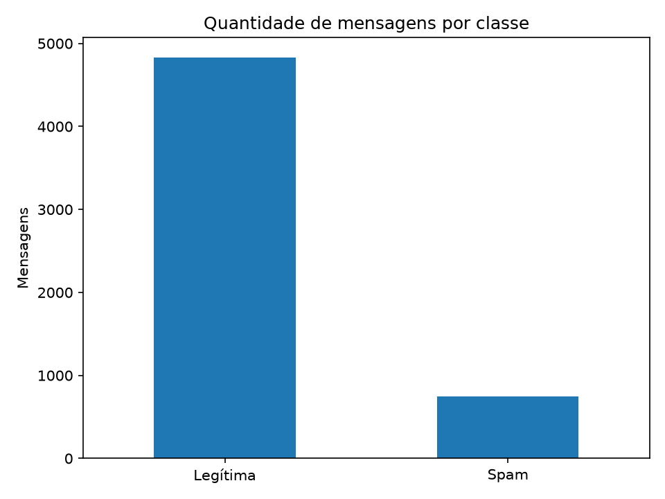
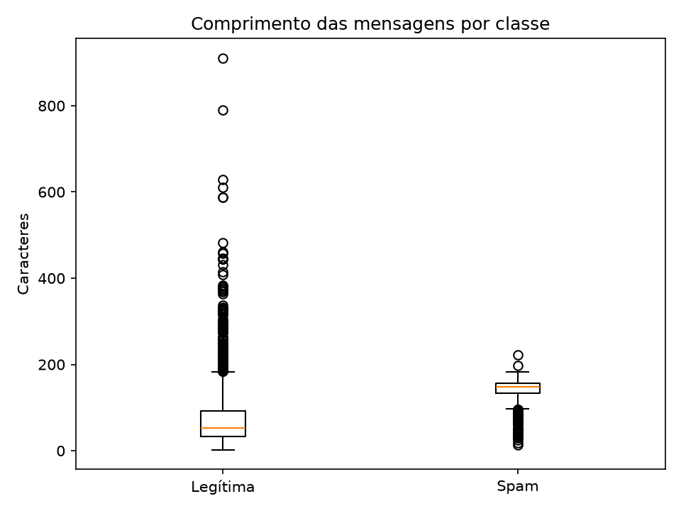
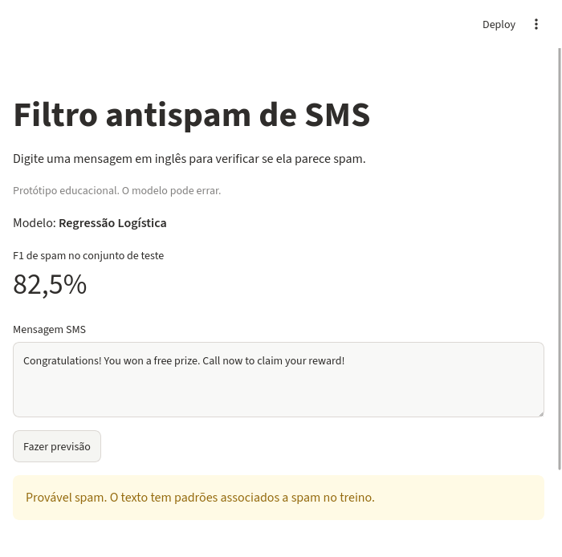

# Filtro antispam de SMS

**Estudante:** Oseney Silva dos Santos

Projeto do ML Challenge que classifica mensagens SMS em inglês como spam ou legítimas. A interface foi feita com Streamlit.

O filtro pode ajudar quem recebe SMS a identificar ofertas suspeitas antes de abrir um link ou responder à mensagem.

## Dados

Usei a [SMS Spam Collection](https://archive.ics.uci.edu/dataset/228/sms), de Tiago Almeida e José Hidalgo, disponibilizada pela UCI sob licença CC BY 4.0. A entrada do modelo é o texto da mensagem e o resultado previsto é `spam` ou `ham` (mensagem legítima).

O formato dos registros, a data de consulta e as instruções de download estão em [data/README.md](data/README.md).

## Como executar, passo a passo

### 1. Preparar o ambiente

O projeto foi preparado com Python 3.14.4. No Linux ou macOS, abra um terminal na pasta raiz do projeto e execute:

```bash
python3 -m venv .venv
source .venv/bin/activate
python -m pip install -r requirements.txt
```

No Windows PowerShell, use:

```powershell
py -3.14 -m venv .venv
.\.venv\Scripts\Activate.ps1
python -m pip install -r requirements.txt
```

Nas próximas vezes, basta ativar o ambiente e não é necessário recriá-lo.

**Para experimentar o filtro**, siga diretamente para a etapa 4. O repositório já inclui o modelo treinado e suas métricas. As etapas 2 e 3 permitem reproduzir o treinamento.

### 2. Obter os dados

1. Abra a página [SMS Spam Collection, da UCI](https://archive.ics.uci.edu/dataset/228/sms).
2. Clique em **Download** para baixar o arquivo ZIP.
3. Extraia o ZIP.
4. Copie o arquivo `SMSSpamCollection` extraído para a pasta `data` deste projeto.

Ao final, este caminho deve existir:

```text
data/SMSSpamCollection
```

### 3. Treinar e comparar os modelos

Com o ambiente ativado, execute:

```bash
python train.py
```

O treinamento analisa a base, compara os dois modelos e atualiza:

- `models/model.joblib`: modelo escolhido;
- `reports/metricas.json`: métricas e matrizes de confusão;
- `reports/graficos/`: dois gráficos da análise exploratória.

### 4. Abrir o aplicativo

Execute:

```bash
python -m streamlit run app.py
```

Abra no navegador o endereço mostrado pelo Streamlit, normalmente `http://localhost:8501`. Para encerrar, volte ao terminal e pressione `Ctrl+C`.

Para conferir o resultado, teste separadamente estas mensagens:

```text
Hi, can you bring my notebook to class tomorrow?
Congratulations! You won a free prize. Call now to claim your reward!
```

A primeira deve aparecer como provável mensagem legítima e a segunda como provável spam.

## Análise exploratória

- Das 5.574 mensagens, 747 eram spam (13,4%). A base tem mais mensagens legítimas do que spam.
- A mediana do comprimento foi de 149 caracteres para spam e 52 para mensagens legítimas.
- Encontrei 414 cópias repetidas com o mesmo rótulo e nenhuma mensagem vazia.



*Figura 1. Há 4.827 mensagens legítimas e 747 spams. Um filtro que aceitasse todas as mensagens acertaria a maioria dos casos, mas deixaria passar todos os spams.*



*Figura 2. A linha no meio de cada caixa indica a mediana. Os spams costumam ser mais longos, mas há mensagens legítimas muito compridas, representadas pelos pontos acima da caixa. Só o tamanho não basta para identificar spam.*

## Preparação e treinamento

Removi as mensagens duplicadas antes da divisão dos dados para evitar que o mesmo texto aparecesse no treino e no teste. Usei uma divisão estratificada de 80% para treino e 20% para teste, com `random_state=42`. Foram 4.128 mensagens de treino e 1.032 de teste.

Usei TF-IDF para transformar os textos em números. O vocabulário foi aprendido somente com os dados de treino. Comparei Naive Bayes e Regressão Logística no mesmo conjunto de teste.

## Resultados

No conjunto de teste havia 904 mensagens legítimas e 128 spams. A precisão indica quantas previsões daquela classe estavam corretas. O recall indica quantas mensagens reais daquela classe o filtro encontrou. O F1 combina as duas medidas.

| Modelo | Classe | Precisão | Recall | F1 |
|---|---|---:|---:|---:|
| Naive Bayes | Legítima | 94,7% | 100,0% | 97,3% |
| Naive Bayes | Spam | 100,0% | 60,2% | 75,1% |
| Regressão Logística | Legítima | 96,2% | 99,7% | 97,9% |
| Regressão Logística | Spam | 96,8% | 71,9% | 82,5% |

Escolhi a Regressão Logística porque obteve o maior F1 para a classe spam. Ela detectou 15 spams a mais que o Naive Bayes e marcou incorretamente 3 mensagens legítimas como spam.

Em um filtro de caixa de entrada, esses 3 falsos positivos poderiam esconder mensagens importantes. Já os 36 falsos negativos deixariam mensagens indesejadas chegar ao usuário.

As métricas completas e as matrizes de confusão estão em [`reports/metricas.json`](reports/metricas.json). A aplicação carrega o modelo salvo em `models/model.joblib`.

## Demonstração

Testei as três mensagens abaixo separadamente na interface do Streamlit.

| Teste | Mensagem digitada | Previsão do modelo |
|---|---|---|
| 1 — Lembrete de aula | Hi, can you bring my notebook to class tomorrow? | Provável mensagem legítima |
| 2 — Oferta de prêmio | Congratulations! You won a free prize. Call now to claim your reward! | Provável spam |
| 3 — Oferta ambígua | Hi! Your discount is available until Friday. Let me know if you want it. | Provável mensagem legítima |

A captura mostra o resultado do teste 2.



## Limitações

- O modelo foi treinado com mensagens em inglês. O desempenho em português não foi avaliado.
- No teste, a Regressão Logística deixou passar 36 spams e marcou 3 mensagens legítimas como spam.

Uma melhoria seria treinar e avaliar o filtro com mensagens rotuladas em português.

## Uso de IA

Usei o ChatGPT como apoio na configuração do ambiente, na elaboração do código e na interpretação dos resultados. Executei o treinamento e testei a aplicação no meu computador.
